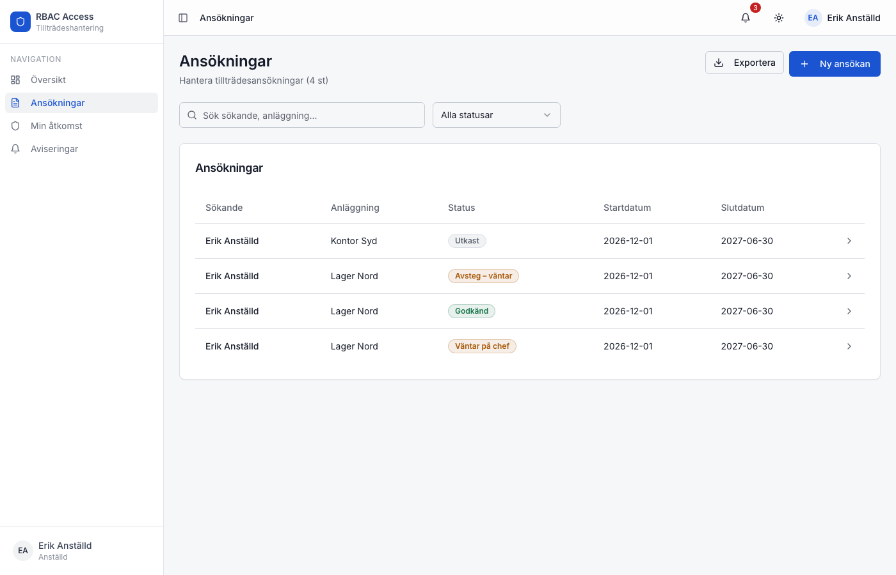
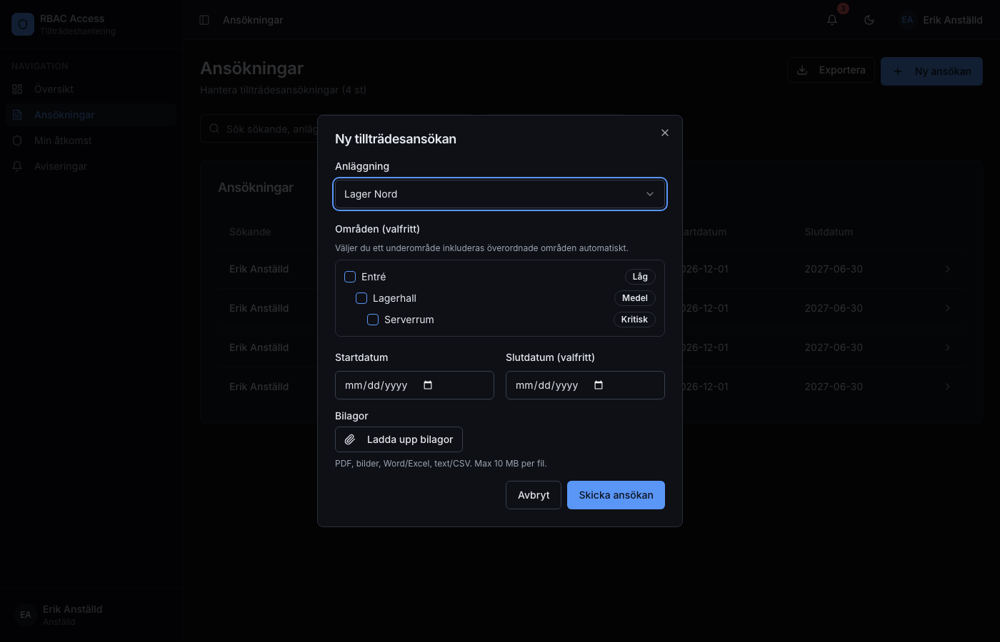
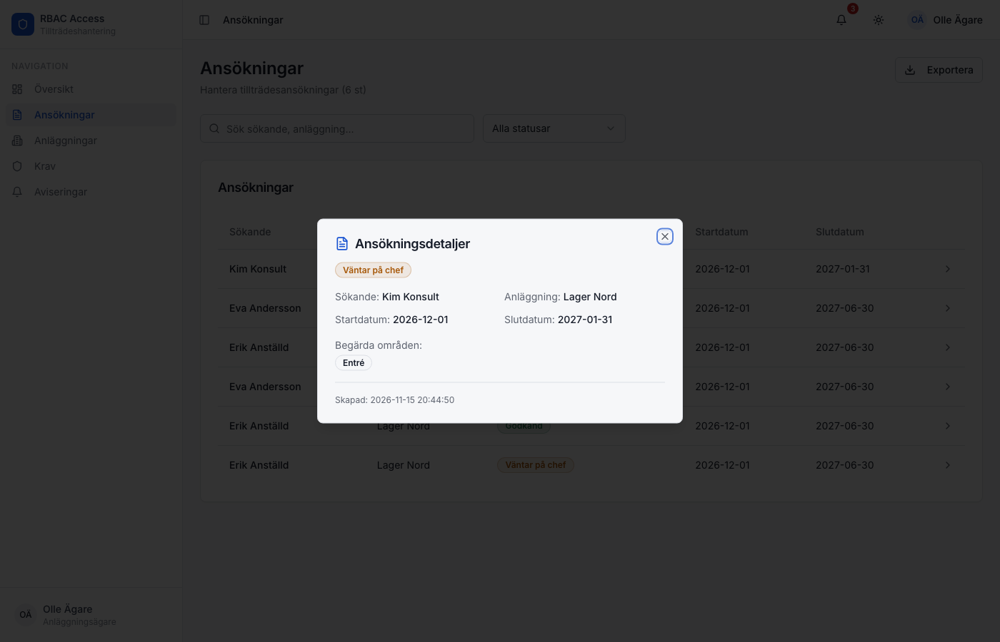
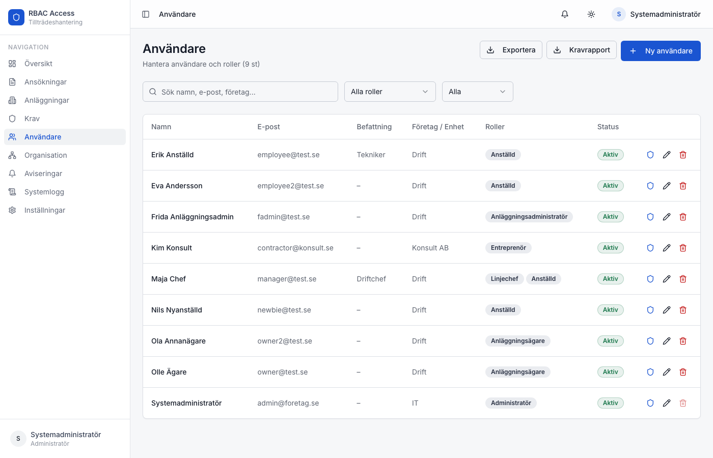
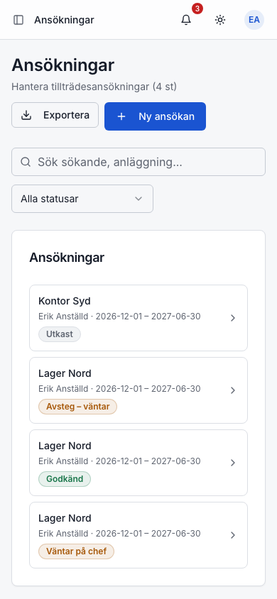
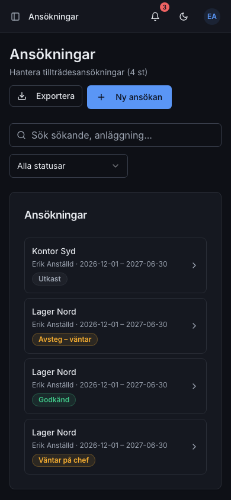
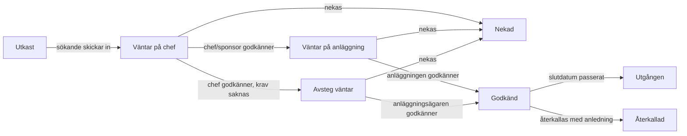
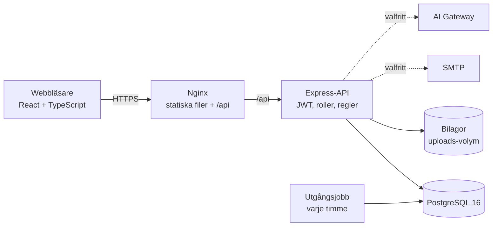

<div align="center">

# Access Guardian

**Rollbaserat system för tillträdesansökningar till anläggningar och områden**

Anställda och entreprenörer ansöker om tillträde, chefer attesterar, anläggningsägare beslutar
och allt loggas. Krav som utbildningar och säkerhetsprövningar följs upp automatiskt.

<br>

[](https://react.dev)
[](https://www.typescriptlang.org)
[](https://vitejs.dev)
[](https://tailwindcss.com)
[](https://ui.shadcn.com)
<br>
[](https://nodejs.org)
[](https://expressjs.com)
[](https://www.postgresql.org)
[](https://docs.docker.com/compose/)
[](https://nginx.org)
<br>
[](https://github.com/calzonswe/access-guardian/commits/main)
[](https://github.com/calzonswe/access-guardian/commits/main)
[](https://github.com/calzonswe/access-guardian)
[](https://github.com/calzonswe/access-guardian)
[](scripts/smoke-test.mjs)
[](#tester-och-kvalitet)

<br>


</div>

---

## Innehåll

- [Funktioner](#funktioner)
- [I siffror](#i-siffror)
- [Skärmbilder](#skärmbilder)
- [Snabbstart](#snabbstart)
- [Första inloggning](#första-inloggning)
- [Roller](#roller)
- [Ansökningsflödet](#ansökningsflödet)
- [Kom igång per roll](#kom-igång-per-roll)
- [Konfiguration](#konfiguration)
- [Teman och utseende](#teman-och-utseende)
- [Lokal utveckling](#lokal-utveckling)
- [Tester och kvalitet](#tester-och-kvalitet)
- [Arkitektur](#arkitektur)
- [Drift](#drift)
- [Säkerhet](#säkerhet)
- [Felsökning](#felsökning)
- [Kända begränsningar](#kända-begränsningar)
- [Mer dokumentation](#mer-dokumentation)

---

## Funktioner

| Område | Vad systemet gör |
|---|---|
| **Ansökningar** | Ansökan om tillträde till en anläggning och valfria områden (med underområden). Utkast, inskickning, redigering medan ansökan väntar på chef, bilagor (PDF, bilder, Word/Excel, text). **Förläng** ett tillträde som snart går ut, eller **ansök igen** efter ett avslag, med ett ifyllt formulär. |
| **Attestering i flera steg** | Närmaste chef eller sponsor attesterar, därefter beslutar anläggningen. Ansökningar som saknar krav (avsteg) beslutas av anläggningsägaren. |
| **Krav** | Utbildningar, certifieringar och säkerhetsprövningar kopplas till anläggningar och områden. Formuläret visar en checklista (uppfyllt, går ut, saknas) och kräver motivering när något saknas. **Vad krävs?** på Min åtkomst visar kraven innan man ansöker. |
| **Uppföljning** | Bakgrundsjobb som markerar utgångna tillträden och krav och skickar påminnelser 30, 7 och 1 dag innan (inställbart). Ansökningar som väntar för länge ger en påminnelse till beslutsfattaren och sedan en eskalering till administratörerna. |
| **Återkallelse** | Anläggningens personal kan återkalla ett beviljat tillträde med en anledning som visas för den sökande. |
| **Entreprenörer** | Publikt ansökningsformulär (med captcha) där externa entreprenörer anger en kontaktperson som attesterar. Kan stängas av i inställningarna. |
| **Aviseringar** | I appen och via e-post (SMTP) vid varje statusändring och när något väntar på ditt beslut. Länkar öppnar rätt ansökan direkt. |
| **Granskningslogg** | Alla ändringar loggas med aktör, tid och detaljer. Sök på text och datum, exportera urvalet. Varje ansökan visar sin egen **historik**. Valfri AI-analys av loggen. |
| **Att hantera** | En räknare i menyn och ett filter visar ansökningar som väntar på just ditt beslut. Chefer kan ange en **ersättare** vid frånvaro. |
| **Aktiva tillträden** | Anläggningens ansvariga ser vem som har tillträde i dag, per område, med export. |
| **Organisation** | Organisationsträd (företag, avdelning, enhet, grupp) och chefskedjor. Chefer ser hela sitt team. |
| **Administration** | Användare och roller (även **import från CSV/Excel**), anläggningar och områden, krav, branding (namn, logotyp, färg), säkerhetsinställningar och lösenordspolicy, systemstatus. Inaktiverade konton förlorar automatiskt sina tillträden. |
| **Utseende** | Ljust och mörkt tema som följer enhetens inställning, fungerar på mobil. |

---

## I siffror

| | |
|---|---|
| **6** roller | administratör, anläggningsägare, anläggningsadministratör, linjechef, anställd, entreprenör |
| **7** ansökningsstatusar | utkast, väntar på chef, väntar på anläggning, avsteg väntar, godkänd, nekad, utgången/återkallad |
| **19** sidor i gränssnittet | inklusive publika sidor för entreprenörer och lösenordsåterställning |
| **16** API-moduler | under `/api/*`, se [openapi.yaml](openapi.yaml) |
| **8** databasmigreringar | körs automatiskt när backend startar |
| **111** API-kontroller | hela flödet och behörigheterna, mot riktig databas ([scripts/smoke-test.mjs](scripts/smoke-test.mjs)) |
| **45** enhetstester | 22 i backend (statusregler, ersättare, påminnelser, import), 23 i frontend |
| **2** teman | ljust och mörkt, plus "följ systemet" |

---

## Skärmbilder

<table>
  <tr>
    <td width="50%"><br><sub>Ansökningar (anställd), ljust tema</sub></td>
    <td width="50%"><br><sub>Ny ansökan med områdesträd, mörkt tema</sub></td>
  </tr>
  <tr>
    <td width="50%"><br><sub>Ansökningsdetaljer</sub></td>
    <td width="50%"><br><sub>Användarhantering (administratör)</sub></td>
  </tr>
</table>

<p align="center">
  
  &nbsp;&nbsp;
  
  <br><sub>Mobilvy i ljust och mörkt tema</sub>
</p>

Skärmbilderna visar påhittad testdata.

---

## Snabbstart

Kräver Docker med Docker Compose v2.

```bash
# 1. Hämta koden
git clone https://github.com/calzonswe/access-guardian.git
cd access-guardian

# 2. Skapa konfigurationen och sätt två hemligheter
cp .env.example .env
#    Ändra DB_PASSWORD och JWT_SECRET i .env (JWT_SECRET minst 32 tecken), t.ex.:
#    openssl rand -hex 32

# 3. Bygg och starta databas, backend och frontend
docker compose up -d --build

# 4. Hämta administratörens första lösenord ur loggen
docker compose logs backend | grep -A3 "INITIAL ADMIN"
```

Öppna sedan **http://localhost:8080** (eller porten du satt i `APP_PORT`).

| Tjänst | Vad den gör | Port |
|---|---|---|
| `db` | PostgreSQL 16, schemat skapas från `db/init.sql` första gången | intern |
| `backend` | Express-API, kör databasmigreringar och bakgrundsjobb vid start | 3000 |
| `frontend` | Nginx som serverar appen och skickar `/api` vidare till backend | 8080 |

Kontrollera att allt är igång:

```bash
docker compose ps
curl http://localhost:8080/api/health    # {"status":"ok","db":"ok"}
```

---

## Första inloggning

| Fält | Värde |
|---|---|
| E-post | `INITIAL_ADMIN_EMAIL`, standard `admin@foretag.se` |
| Lösenord | `INITIAL_ADMIN_PASSWORD` om den är satt, annars ett slumpat lösenord som skrivs ut **en gång** i backend-loggen |

Du måste byta lösenord vid första inloggningen. Backend skapar administratören bara om det inte finns någon administratör alls i databasen, så kontot återskapas aldrig av misstag.

> Utan backend (till exempel Lovable-förhandsvisningen eller `npm run dev`) körs appen i webbläsarläge med data i `localStorage`. Där är inloggningen `admin@company.local` / `Admin123!`.

---

## Roller

En användare kan ha flera roller. Menyn visar bara det som rollen får använda.

| Roll | Vad rollen gör | Sidor |
|---|---|---|
| **Administratör** | Hanterar allt: användare, roller, anläggningar, krav, organisation och inställningar. Får utföra varje steg i flödet. | Alla |
| **Anläggningsägare** | Beslutar om ansökningar till sina anläggningar, inklusive avsteg. Återkallar tillträden, hanterar områden och utser anläggningsadministratörer. | Översikt, Ansökningar, Anläggningar, Krav |
| **Anläggningsadministratör** | Beslutar om ansökningar till de anläggningar hen administrerar (ej avsteg), hanterar områden och återkallar tillträden. | Översikt, Ansökningar, Anläggningar, Krav |
| **Linjechef** | Attesterar ansökningar från sitt team (hela chefskedjan nedåt) och följer teamets krav och tillträden. | Översikt, Ansökningar, Krav, Mitt team |
| **Anställd** | Ansöker om tillträde och följer sina ansökningar, krav och aktiva tillträden. | Översikt, Ansökningar, Min åtkomst |
| **Entreprenör** | Som anställd, men attesteras av sin kontaktperson (sponsor). Skapas via det publika formuläret eller av en administratör. | Översikt, Ansökningar, Min åtkomst |

Alla roller har dessutom Aviseringar och Min profil. Behörigheterna kontrolleras i backend, inte bara i gränssnittet.

---

## Ansökningsflödet



| Steg | Vem beslutar | Regler |
|---|---|---|
| Utkast → Väntar på chef | Den sökande | Utkast syns bara för den sökande (och administratörer). Nya ansökningar skickas in direkt. |
| Väntar på chef | Närmaste chef eller kontaktperson | Den sökande kan aldrig attestera sin egen ansökan, inte heller kollegor till varandra. Saknar den sökande chef går ansökan till administratörerna. |
| Väntar på anläggning | Ägaren eller en administratör **för just den anläggningen** | |
| Avsteg väntar | Anläggningsägaren | Gäller ansökningar där den sökande saknar krav och har lämnat en motivering. |
| Godkänd → Utgången | Bakgrundsjobbet | Körs varje timme. Påminnelser skickas innan. |
| Godkänd → Återkallad | Anläggningens personal | Kräver en anledning, som visas för den sökande. |

Den sökande kan redigera sin ansökan så länge den väntar på chef. Varje övergång loggas och utlöser aviseringar till den sökande och till den som ska fatta nästa beslut. Reglerna finns i en tabell (`TRANSITIONS` i `backend/src/routes/applications.js`) med egna tester.

---

## Kom igång per roll

<details>
<summary><strong>Anställd eller entreprenör: ansök om tillträde</strong></summary>

1. Gå till **Ansökningar** och välj **Ny ansökan**.
2. Välj anläggning. Välj områden om du bara behöver vissa delar; väljer du ett underområde tas områdena ovanför med automatiskt.
3. Ange startdatum och vid behov slutdatum.
4. Saknar du ett krav visas en varning. Skriv en motivering så hanteras ansökan som ett avsteg.
5. Bifoga intyg om du har dem och välj **Skicka ansökan**.

Under **Min åtkomst** ser du dina aktiva tillträden och vilka krav du uppfyller, och **Vad krävs?** visar kraven för en anläggning innan du ansöker. Du får en avisering vid varje beslut.

Går ett tillträde snart ut? Öppna det och välj **Förläng** (eller följ länken i påminnelsen). Har en ansökan nekats kan du välja **Ansök igen** och rätta det som saknades.
</details>

<details>
<summary><strong>Linjechef: attestera</strong></summary>

1. **Översikt** visar ansökningar som väntar på dig. Du får också en avisering.
2. Öppna ansökan, läs den och välj **Godkänn** eller **Neka** (med anledning).
3. Godkända ansökningar går vidare till anläggningen, eller till anläggningsägaren om de innehåller avsteg.

**Mitt team** visar varje medarbetares krav, aktiva tillträden och väntande ansökningar.

Ska du vara borta? Ange en **ersättare** med datum under **Min profil**. Under perioden kan ersättaren attestera dina medarbetares ansökningar och får aviseringarna.
</details>

<details>
<summary><strong>Anläggningsägare eller anläggningsadministratör: besluta och förvalta</strong></summary>

1. **Översikt** visar ansökningar att granska. Ägaren ser även avsteg att besluta.
2. Öppna ansökan och välj **Godkänn** eller **Neka**.
3. För att dra in ett tillträde: öppna den godkända ansökan, välj **Återkalla** och ange en anledning.
4. Under **Anläggningar** hanterar du områden (med säkerhetsnivå och underområden). Ägaren utser anläggningsadministratörer via **Hantera**.
5. **Aktiva tillträden** på anläggningskortet visar vem som har tillträde i dag, filtrerat per område, med export till CSV.
</details>

<details>
<summary><strong>Administratör: sätt upp systemet</strong></summary>

1. **Användare**: skapa konton, ge roller och ange närmaste chef. Nya användare får en länk via e-post om SMTP är konfigurerat. Många på en gång: **Importera** en CSV-fil (mall finns i dialogen); nya användare får tillfälliga lösenord som visas en gång. Att inaktivera ett konto återkallar dess tillträden och drar tillbaka väntande ansökningar.
2. **Organisation**: bygg organisationsträdet och ange chefer.
3. **Anläggningar**: skapa anläggningar, välj ägare och lägg till områden.
4. **Krav**: skapa krav (med giltighetstid i dagar om de går ut) och koppla dem till anläggningar och områden. Registrera uppfyllda krav per användare via skölden i användarlistan.
5. **Inställningar**: branding, aviseringar, entreprenörsformuläret, sessionstid, inloggningsspärr och lösenordspolicy. Fliken **System** visar status för databas, e-post och bakgrundsjobb.
6. **Systemlogg**: filtrera, exportera och (valfritt) ställ frågor till AI-analysen.
</details>

---

## Konfiguration

### Miljövariabler (`.env`)

| Variabel | Krävs | Standard | Beskrivning |
|---|:---:|---|---|
| `DB_PASSWORD` | Ja | | Lösenord till PostgreSQL |
| `DB_APP_USER` / `DB_APP_PASSWORD` | | ägarkontot | Kör backend med ett konto med begränsade rättigheter, se [Drift](#databaskonto-med-begränsade-rättigheter) |
| `JWT_SECRET` | Ja | | Nyckel för inloggningstokens, minst 32 tecken |
| `APP_PORT` | | `8080` | Porten där appen nås |
| `INITIAL_ADMIN_EMAIL` | | `admin@foretag.se` | Första administratörens e-post |
| `INITIAL_ADMIN_PASSWORD` | | slumpas | Första administratörens lösenord |
| `APP_BASE_URL` | Vid SMTP | | Appens publika adress, används i länkar i e-post (t.ex. `https://access.foretag.se`) |
| `SMTP_HOST` | | tom = ingen e-post | SMTP-server. Aviseringar fungerar i appen även utan e-post. |
| `SMTP_PORT` / `SMTP_SECURE` | | `587` / `false` | `SMTP_SECURE=true` för port 465 |
| `SMTP_USER` / `SMTP_PASS` | | | Inloggning till SMTP-servern |
| `SMTP_FROM` | | `no-reply@access-guardian.local` | Avsändare |
| `CORS_ORIGIN` | | `*` | Tillåtna ursprung, kommaseparerade. Begränsa i produktion. |
| `CSP_CONNECT_SRC` | | `'self'` | Lägg till API-värden om `VITE_API_URL` pekar på en annan domän |
| `VITE_API_URL` | | `/api` | API-adress för frontend (byggtid) |
| `API_RATE_LIMIT_MAX` | | `600` | Max antal API-anrop per användare och fönster |
| `API_RATE_LIMIT_WINDOW_MS` | | `60000` | Fönstrets längd i ms |
| `EXPIRY_JOB_INTERVAL_MS` | | `3600000` | Hur ofta utgångsjobbet körs. `0` stänger av det. |
| `LOVABLE_API_KEY` | | tom = av | Aktiverar AI-analys av granskningsloggen |
| `AI_MODEL` | | `openai/gpt-6-astra` | Modell för AI-analysen |
| `LOG_LEVEL` / `LOG_FORMAT` | | `info` / `json` i Docker | Backendens loggnivå och format (`json` eller `text`) |

### Inställningar i appen

Under **Inställningar** (administratör):

| Flik | Innehåll |
|---|---|
| Allmänt | Organisationsnamn, publikt entreprenörsformulär på/av |
| Branding | Applikationsnamn, undertitel, logotyp (https-adress) och primärfärg |
| Aviseringar | Påminnelser 30, 7 och 1 dag före utgång, e-post på/av, påminnelse och eskalering för ansökningar som väntar (standard 3 och 7 dagar, 0 = av) |
| Autentisering | Sessionstid, max misslyckade inloggningar, spärrtid och lösenordspolicy |
| System | Status för databas, e-post och bakgrundsjobb; kör utgångsjobbet manuellt |

---

## Teman och utseende

- **Ljust och mörkt tema.** Välj under sol/måne-knappen i sidhuvudet: *Ljust*, *Mörkt* eller *Följ systemet* (standard). Valet sparas per webbläsare och tillämpas innan sidan ritas, så det blinkar inte.
- **Egen primärfärg.** Färgen från Branding används i båda temana. I mörkt tema ljusas den upp automatiskt så att text och knappar förblir läsbara.
- **Mobil.** Menyn fälls ihop, sidhuvuden radbryts och ansökningslistan visas som kort.
- **Tillgänglighet.** Synlig tangentbordsmarkering, etiketter på alla ikonknappar, rader som går att öppna med tangentbordet och färre animationer när enheten ber om det.

---

## Lokal utveckling

Krav: Node.js 20 eller senare (Docker-avbilderna använder 24 LTS) och npm. npm är enda pakethanteraren.

**Bara frontend (ingen databas behövs)**

```bash
npm install
npm run dev          # http://localhost:8080, körs i webbläsarläge med localStorage
```

**Frontend och backend**

```bash
# Databas: PostgreSQL 16 med schemat, nåbar på localhost:5432
docker run -d --name ag-dev-db -p 5432:5432 \
  -e POSTGRES_DB=rbac_access -e POSTGRES_USER=rbac_user -e POSTGRES_PASSWORD=dev_password \
  -v "$(pwd)/db/init.sql:/docker-entrypoint-initdb.d/01-init.sql:ro" \
  postgres:16-alpine

# Backend (migreringarna i db/migrations körs automatiskt vid start)
cd backend
npm install
export DB_HOST=localhost DB_PORT=5432 DB_NAME=rbac_access DB_USER=rbac_user \
       DB_PASSWORD=dev_password JWT_SECRET=$(openssl rand -hex 32)
npm run dev          # http://localhost:3000, startar om vid ändringar
```

Frontend avgör själv vilket läge den kör i: svarar `/api/health` med `{"status":"ok"}` används backend, annars localStorage. Sätt `VITE_LOCAL_MODE=true` för att tvinga fram webbläsarläget.

### Kommandon

| Uppgift | Kommando |
|---|---|
| Frontend, utvecklingsserver | `npm run dev` |
| Frontend, produktionsbygge | `npm run build` |
| Lint | `npm run lint` |
| Frontendtester | `npm run test` (en gång) / `npm run test:watch` |
| Ett enskilt test | `npx vitest run src/lib/utils.test.ts` |
| Backend, utvecklingsserver | `cd backend && npm run dev` |
| Backendtester | `cd backend && npm test` |
| Hela stacken | `docker compose up -d --build` |

---

## Tester och kvalitet

| Nivå | Vad som testas | Kör |
|---|---|---|
| **Backend, enhet** (22) | Statusreglerna, ersättarperioder, påminnelser och CSV-importens validering | `cd backend && npm test` |
| **Frontend, enhet** (23) | Ansökningsregler (att hantera, förläng, aktiva tillträden), CSV-läsning, tokenhantering, logotyp och brandfärg | `npm run test` |
| **API end-to-end** (111) | Hela flödet och behörigheterna mot en riktig databas: inloggning, ansökningar, avsteg, entreprenörer, återkallelse, förlängning, historik, ersättare, inaktivering, chefsbyte, import och loggsök | se nedan |

API-testet skapar egna användare och kräver därför en **tom** databas. Kör det i ett separat Compose-projekt så att riktig data inte påverkas:

```bash
cat > /tmp/smoke.env <<'EOF'
DB_PASSWORD=smoke_db_pw
JWT_SECRET=0123456789abcdef0123456789abcdef0123456789abcdef
INITIAL_ADMIN_PASSWORD=Smoke-Admin-1!
APP_PORT=8088
EOF
docker compose -p ag-smoke --env-file /tmp/smoke.env up -d --build
ADMIN_PW='Smoke-Admin-1!' node scripts/smoke-test.mjs
docker compose -p ag-smoke --env-file /tmp/smoke.env down -v
```

Lint och typkontroll ska vara utan fel innan en ändring checkas in.

---

## Arkitektur



**Frontend** (`src/`): React 18, TypeScript, Vite, Tailwind CSS och shadcn/ui. Sidorna hämtar data via `src/services/dataStore.ts`, som antingen pratar med API:t eller använder `localStorage`. Roller styr menyn och vilka sidor som går att öppna.

**Backend** (`backend/src/`): Express i vanlig JavaScript utan byggsteg. JWT-inloggning, rollkontroller per anrop, granskningslogg, e-post, bakgrundsjobb och migreringar som körs vid start.

**Databas** (`db/`): `init.sql` skapar schemat på en tom databas, `migrations/` uppdaterar befintliga databaser automatiskt.

```
access-guardian/
├── src/                      Frontend
│   ├── pages/                Sidor (19)
│   ├── components/           Layout, dialoger och shadcn/ui-komponenter
│   ├── context/              Inloggning, tema och branding
│   ├── services/             API-klient och datalager
│   └── types/                Domäntyper
├── backend/
│   ├── src/routes/           API-moduler (16)
│   ├── src/middleware/       Inloggning, roller, begränsning av anrop
│   ├── src/services/         Logg, e-post, inställningar, AI, captcha
│   ├── src/jobs/             Utgångsjobb
│   └── test/                 Tester för statusreglerna
├── db/
│   ├── init.sql              Grundschema
│   ├── migrations/           Numrerade migreringar (körs vid start)
│   └── least-privilege.sql   Databaskonto med begränsade rättigheter
├── scripts/smoke-test.mjs    API-test end-to-end
├── docs/images/              Skärmbilder
├── docker-compose.yml        db, backend, frontend
├── Dockerfile                Frontend (bygg + Nginx)
└── nginx.conf.template       Proxy, cache och säkerhetshuvuden
```

---

## Drift

### Uppgradera

```bash
git pull
docker compose up -d --build
```

Nya databasmigreringar körs automatiskt när backend startar. Följ loggen med `docker compose logs -f backend`.

### Backup

All data finns i två Docker-volymer:

| Volym | Innehåll |
|---|---|
| `postgres_data` | Databasen: användare, ansökningar, loggar och inställningar |
| `uploads_data` | Uppladdade bilagor och intyg |

**Manuell backup**

```bash
docker compose exec -T db pg_dump -U rbac_user rbac_access | gzip > backup-db.sql.gz
docker run --rm -v access-guardian_uploads_data:/data -v "$(pwd)":/backup alpine \
  tar czf /backup/backup-uploads.tar.gz -C /data .
```

**Nattlig backup** (cron på värden, sparar 14 dagar):

```bash
0 2 * * * root cd /opt/access-guardian && \
  docker compose exec -T db pg_dump -U rbac_user rbac_access | gzip > \
  /var/backups/access-guardian/db-$(date +\%Y\%m\%d).sql.gz && \
  tar czf /var/backups/access-guardian/uploads-$(date +\%Y\%m\%d).tar.gz \
  -C /var/lib/docker/volumes/access-guardian_uploads_data/_data . && \
  find /var/backups/access-guardian -type f -mtime +14 -delete
```

**Återställning**

```bash
docker compose stop backend
gunzip -c backup-db.sql.gz | docker compose exec -T db psql -U rbac_user rbac_access
docker run --rm -v access-guardian_uploads_data:/data -v "$(pwd)":/backup alpine \
  sh -c "cd /data && tar xzf /backup/backup-uploads.tar.gz"
docker compose start backend
```

Prova återställningen regelbundet i en testmiljö.

### Databaskonto med begränsade rättigheter

För produktion kan backend köras med ett konto som bara läser och skriver data:

```bash
docker compose cp db/least-privilege.sql db:/tmp/least-privilege.sql
docker compose exec -T db psql -U rbac_user rbac_access \
  -v app_password="'<starkt-lösenord>'" -f /tmp/least-privilege.sql
```

Lägg sedan till i `.env` och starta om backend (`docker compose up -d backend`):

```env
DB_APP_USER=rbac_app
DB_APP_PASSWORD=<starkt-lösenord>
```

Vid uppgraderingar med nya migreringar: kommentera bort de två raderna, starta backend en gång så att migreringarna tillämpas som ägarkontot, och lägg sedan tillbaka dem.

---

## Säkerhet

- **Inloggning:** lösenord hashas med bcrypt. Tokens förnyas medan användaren är aktiv och slutar gälla vid inaktivitet, vid lösenordsbyte och när kontot inaktiveras.
- **Lösenord:** policyn ställs in av administratören. Byte kräver nuvarande lösenord, och återställningslänkar kan bara användas en gång.
- **Spärrar:**
  - Kontot spärras tillfälligt efter för många misslyckade inloggningar (standard 5 försök, 15 minuter).
  - Varje användare har en gräns för antal API-anrop.
  - Det publika formuläret har captcha och en gräns per IP-adress.
- **Behörighet:** varje anrop kontrolleras i backend mot roll och koppling: rätt anläggning, rätt chefskedja, egen ansökan.
- **Spårbarhet:** alla ändringar loggas i granskningsloggen. Text som användare skrivit escapas i e-post.
- **Nginx:**
  - Säkerhetshuvuden: CSP, X-Frame-Options och Referrer-Policy.
  - Typsnitt levereras från den egna servern, så inga anrop går till tredje part.

---

## Felsökning

| Problem | Lösning |
|---|---|
| Containrarna startar inte | `docker compose logs db` och `docker compose logs backend`. Kontrollera att `DB_PASSWORD` och `JWT_SECRET` (minst 32 tecken) är satta. |
| Hittar inte första lösenordet | `docker compose logs backend \| grep -A3 "INITIAL ADMIN"`. Det skrivs bara ut när administratören skapas. Sätt annars `INITIAL_ADMIN_PASSWORD` på en tom databas. |
| "Kontot är tillfälligt låst" | Vänta spärrtiden (standard 15 minuter) eller ändra gränsen under Inställningar → Autentisering. |
| "Servern svarar inte just nu" | Backend eller databas är nere. Kontrollera `docker compose ps` och `curl http://localhost:8080/api/health`. |
| Appen visar ingen data alls | Du kör troligen i webbläsarläge (`npm run dev` utan backend). Data finns då bara i den här webbläsaren. |
| Länkar i e-post fungerar inte | Sätt `APP_BASE_URL` till appens publika adress. |
| Ingen e-post skickas | Kontrollera SMTP-variablerna och fliken Inställningar → System. E-post kan också vara avstängd under Aviseringar. |
| Entreprenörsformuläret svarar "avstängd" | Slå på det under Inställningar → Allmänt. |
| Börja om med tom databas | `docker compose down -v && docker compose up -d --build` (raderar all data). |

---

## Kända begränsningar

- **Inloggning:** endast lokal inloggning med e-post och lösenord. Entra ID/Azure AD, SAML och tvåfaktorsautentisering finns inte ännu.
- **E-postadress:** kan bara ändras av en administratör.
- **Interaktiv API-dokumentation:** finns inte; se [openapi.yaml](openapi.yaml).
- **Stora listor:** användar- och ansökningslistan pagineras på servern, men övriga listor hämtas i sin helhet.

Planerat arbete finns i [roadmap.md](roadmap.md).

---

## Mer dokumentation

| Dokument | Innehåll |
|---|---|
| [TECHNICAL.md](TECHNICAL.md) | Teknisk dokumentation: databasschema, API-referens, roller och sidor |
| [MANUAL.md](MANUAL.md) | Användarhandledning (engelska) |
| [openapi.yaml](openapi.yaml) | API-schema |
| [REVIEW.md](REVIEW.md) | Kodgranskning och åtgärdslista |
| [ROLE-TEST.md](ROLE-TEST.md) | Test av gränssnittet roll för roll |
| [CLAUDE.md](CLAUDE.md) | Instruktioner för AI-assisterad utveckling |
| [roadmap.md](roadmap.md) | Planerade funktioner |
